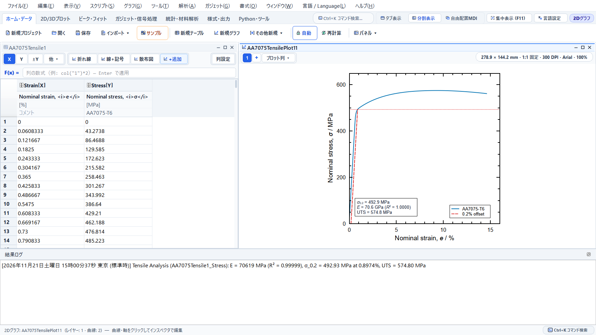

# ToriGraph

[English](README.md) | **日本語**

[](https://github.com/kzykshmz/ToriGraph/actions/workflows/main.yml)
[](LICENSE)
[](#ソースからのビルド)
[](python/README.md)

**ToriGraph** は、[SciDAVis](https://github.com/SciDAVis/scidavis) をベースに改変・拡張したオープンソースの科学グラフ作成・データ解析ソフトウェアです。論文投稿品質の作図、材料科学・分光解析ワークベンチ、Windows PowerPoint へのネイティブ OLE 埋め込み・再編集（`ToriGraph.Graph.1`）、およびヘッドレス Python / AI エージェント自動化に対応しています。



---

## 主な特徴

- **論文投稿品質の 2D / 3D グラフ作成**
  - 正方形プロット枠、四辺内向き目盛り、Arial フォントを既定とした論文向け体裁と、高解像度 PNG / PDF / SVG / EMF+ ベクター出力に対応。
  - 散布図・折れ線・Y オフセットスタック・連動/拡大インセットレイヤー・箱ひげ/バイオリン・三角図・ウォーターフォール・スペクトログラム・等高線・ワイブル確率紙・3D 曲面など 40 種以上のグラフ種をサポート。
  - キャンバス上の直接操作、グラフインスペクタドック、カラーパレット管理、ミニツールバー、ページ単位の Undo / Redo を備えたモダンなリボン＋ドック UI。
- **Windows PowerPoint ネイティブ OLE 連携（`ToriGraph.Graph.1`）**
  - ベクターグラフを PowerPoint スライドへ OLE オブジェクトとして埋め込み、スライド上でダブルクリックして ToriGraph でそのまま再編集できます。
  - Python SDK の `to_pptx()` により、PowerPoint 本体を起動せずクリップボードも汚さずに編集可能な OLE スライドを直接生成できます（Zero-COM）。
- **材料科学・分光解析ワークベンチ**
  - ピーク自動検出、マルチピーク非線形フィッティング（58 種以上の組込モデル、制約付き/重み付き/ロバスト回帰）、ベースライン補正、ピーク積分。
  - 引張試験解析（ヤング率・0.2% 耐力・UTS・Kocks–Mecking 加工硬化率）、XRD・分光解析、EIS（ナイキスト/ボード線図）、アレニウス・Tauc プロット、ワイブル解析、Savitzky–Golay / LOWESS / Whittaker 平滑化、FFT、グラフデジタイザを内蔵。
  - ワークシートの Long Name / Units / `F(x)=` 自動再計算、装置 CSV / RAS および `.opj` / `.opju` ファイルの読込に対応。
- **日本語・英語のバイリンガル UI**
  - 組込の日本語翻訳辞書により起動時から完全に日本語化され、英語 UI への切替も即時に行えます。
- **Python JSON-RPC 2.0 自動化 SDK（`torigraph`）**
  - Python 3.8+ 標準ライブラリのみで動作するクライアント SDK（[python/README.md](python/README.md)）。NumPy / Pandas / Polars 直接入出力、一括実行（`with app.batch():`）、自動レイアウト調整（`auto_layout()`）、再現スクリプト逆生成（`to_python_script()`）に対応。

---

## クイックスタート

### 1. Windows OLE サーバーの登録（PowerPoint でのダブルクリック再編集用）

`ToriGraph.exe` をビルドまたは配置した後、ユーザー単位（`HKCU`・管理者権限不要）で OLE サーバーを登録します。

```powershell
# 現在の登録状態を確認
powershell -ExecutionPolicy Bypass -File scripts/register-ole.ps1 -Mode Inspect

# OLE サーバーを登録 (ToriGraph.Graph.1)
powershell -ExecutionPolicy Bypass -File scripts/register-ole.ps1 -Mode Install

# 登録解除する場合
powershell -ExecutionPolicy Bypass -File scripts/register-ole.ps1 -Mode Uninstall
```

### 2. Python 自動化 SDK

```bash
pip install -e ./python
# オプション: PowerPoint ネイティブ OLE デッキ出力 (to_pptx) を使う場合のみ必要
pip install python-pptx
```

```python
import numpy as np
import pandas as pd
import torigraph as tg

with tg.launch(headless=True, language="ja") as app:
    x = np.linspace(0.0, 10.0, 201)
    df = pd.DataFrame({"Time": x, "Signal": np.exp(-0.3 * x) * np.sin(2.0 * x)})
    df.attrs["units"] = {"Time": "s", "Signal": "a.u."}

    g = app.plot_xy(df, "Time", "Signal", style="line", lw=1.8, color="#0072B2")
    g.export("figure1.png", dpi=600)
    g.to_pptx("slides.pptx", preset="slide_28pt")
```

詳細は [python/README.md](python/README.md) を参照してください。

---

## ソースからのビルド

### 必要環境（Windows / MSVC）

- CMake 3.16 以上、Visual Studio（C++17）
- Qt 5（5.12 以上 / 5.15：Core, Gui, Widgets, Svg, Network, PrintSupport, Xml, OpenGL, LinguistTools）
- GSL、muParser、zlib（`vcpkg` などで導入）
- Git サブモジュール（`3rdparty/qwt5-qt5`, `3rdparty/liborigin`）

### ビルド手順

```powershell
git clone --recursive https://github.com/kzykshmz/ToriGraph.git
cd ToriGraph

cmake -B build -DCMAKE_TOOLCHAIN_FILE=<vcpkgのパス>/scripts/buildsystems/vcpkg.cmake `
  -DORIGIN_IMPORT=ON -DBUILD_TESTS=ON
cmake --build build --config Release --parallel
```

Linux / macOS 向けの従来のビルド手順については [INSTALL.md](INSTALL.md) を参照してください。

---

## ライセンス

ToriGraph は **SciDAVis** をベースにした派生ソフトウェアです。

- **Copyright (C) 2026 Kazuyuki Shimizu / ToriGraph Project**（ToriGraph による改変・拡張部分）
- **Copyright (C) SciDAVis & QtiPlot Contributors**（元のコードベース。詳細なクレジットは [README.md](README.md#credits) を参照）

本ソフトウェアは **GNU General Public License v2.0 以降（`GPL-2.0-or-later`）** の条件のもとで公開されているフリーソフトウェアです。無保証（WITHOUT ANY WARRANTY）で提供されます。

- ライセンス全文：[LICENSE](LICENSE) / [gpl.txt](gpl.txt)
- **ビルド済みバイナリの配布について**：コンパイル済みバイナリは GSL・Qt 5・liborigin などの GPL-3.0 以降 / LGPL-3.0 ライブラリとリンクされるため、バイナリ全体としては **GNU General Public License v3.0 以降（`GPL-3.0-or-later`）** の条件が適用されます。
- サードパーティライブラリのライセンス一覧：[THIRD_PARTY_LICENSES.md](THIRD_PARTY_LICENSES.md)

---

## 商標について

*Origin* および *OriginPro* は OriginLab Corporation の登録商標です。*Microsoft*、*Windows*、*PowerPoint* は Microsoft Corporation の商標または登録商標です。*ISIJ International* は一般社団法人日本鉄鋼協会の刊行物です。ToriGraph は独立したオープンソースプロジェクトであり、これらの企業・団体とは一切関係ありません。
