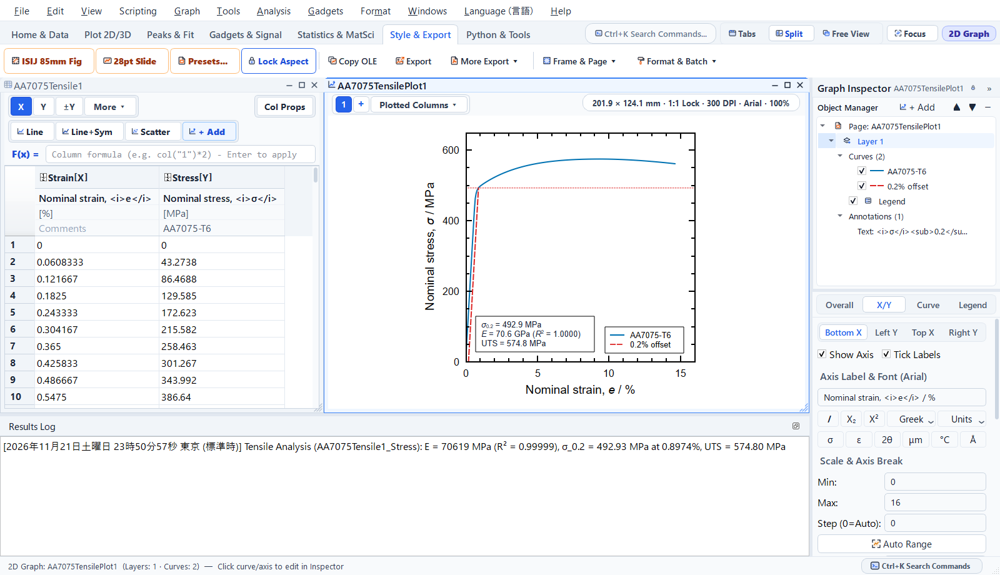

# ToriGraph

**English** | [日本語](README.ja.md)

[](https://github.com/kzykshmz/ToriGraph/actions/workflows/main.yml)
[](https://github.com/kzykshmz/ToriGraph/releases/latest)
[](LICENSE)
[](#installation-windows)
[](python/README.md)

**ToriGraph** is an open-source scientific plotting and data analysis application derived from [SciDAVis](https://github.com/SciDAVis/scidavis), extended for publication-grade figures, materials science workflows, native Windows PowerPoint OLE embedding (`ToriGraph.Graph.1`), and headless Python / AI-agent automation.



---

## Key Features

- **Publication-Ready 2D & 3D Graphing**
  - Default 2D styling tailored for journal submission: square frame, inward ticks on all four sides, Arial typography, and crisp high-DPI PNG / PDF / SVG / EMF+ vector output.
  - 40+ scientific plot types including scatter/line, stacked Y-offset, dual/multi-layer, linked/inset zoom layers, box/violin/jitter, ternary, waterfall, spectrogram, contour, Weibull probability paper, and 3D surfaces.
  - Direct canvas manipulation, Origin-style Plot Details / Graph Inspector dock, color palette manager, mini-toolbar, and page-level undo/redo.
- **Native Windows PowerPoint OLE Integration (`ToriGraph.Graph.1`)**
  - Copy and embed editable vector graphs directly into Microsoft PowerPoint slides and double-click to re-open and edit them in ToriGraph.
  - Supports **Zero-COM `.pptx` generation** via the Python SDK (`to_pptx`), embedding editable OLE graphs without launching PowerPoint or touching the clipboard.
- **Materials Science & Spectroscopy Workbench**
  - Peak analyzer with automatic peak detection, multi-peak nonlinear fitting (58+ built-in models, constrained/weighted/robust fitting), baseline subtraction, and peak integration.
  - Built-in analyses for tensile testing (Young's modulus, 0.2% offset yield stress, UTS, Kocks–Mecking work-hardening), XRD / spectroscopy, EIS (Nyquist/Bode), Arrhenius & Tauc plots, Weibull reliability analysis, Savitzky–Golay / LOWESS / Whittaker smoothing, FFT, and graph digitization.
  - Worksheet Long Name / Units / `F(x)=` dynamic recalculation, 20 built-in materials science & metal mechanics sample datasets / multi-window project packs, and import support for instrument CSV/RAS and legacy Origin project files (`.opj` / `.opju`).
- **Full Bilingual UI (Japanese / English) & Built-In Auto-Updater**
  - Complete built-in Japanese and English interface with instant switching and unified modern ribbon + dock layout.
  - Built-in GitHub Releases auto-updater with SHA-256 verification and silent in-place update support.
- **Headless Python Automation SDK (`torigraph`)**
  - Zero-dependency pure-Python 3.8+ JSON-RPC 2.0 client ([python/README.md](python/README.md)) supporting NumPy, Pandas (`attrs["units"]` / `attrs["long_names"]`), Polars, atomic batching (`with app.batch():`), self-healing layout (`auto_layout()`), and reproducible script export (`to_python_script()`).

---

## Installation (Windows)

### All-in-One Windows Installer (Recommended)

Download the latest **`ToriGraph-<version>-win64-setup.exe`** from **[GitHub Releases](https://github.com/kzykshmz/ToriGraph/releases/latest)** and run it.

The integrated installer sets up everything in one step (per-user installation by default, **no administrator privileges required**):

- **ToriGraph** desktop application (all Qt5 / GSL / muParser runtimes, fit plugins, and Japanese/English translations bundled)
- **Windows OLE Server (`ToriGraph.Graph.1`)** registration for PowerPoint / Word double-click in-place graph re-editing
- **Python Automation SDK (`torigraph`)** installed offline into your detected Python 3.8+ environment, plus `TORIGRAPH_EXE` and user `PATH` setup
- **`.sciprj` project file association** and Start Menu repair shortcuts
- **Automatic updates** directly from GitHub Releases (Help → Check for Updates)

A standalone **Portable ZIP** (`ToriGraph-<version>-win64-portable.zip`) is also available on the Releases page.

---

## Quick Start

### 1. Manual OLE Server Registration (Portable / Source Builds Only)

After building or obtaining `ToriGraph.exe`, register the per-user OLE server (`HKCU`, no administrator privileges required):

```powershell
# Inspect current OLE registration
powershell -ExecutionPolicy Bypass -File scripts/register-ole.ps1 -Mode Inspect

# Install OLE registration (ToriGraph.Graph.1)
powershell -ExecutionPolicy Bypass -File scripts/register-ole.ps1 -Mode Install

# Uninstall if needed
powershell -ExecutionPolicy Bypass -File scripts/register-ole.ps1 -Mode Uninstall
```

### 2. Python Automation SDK

```bash
pip install -e ./python
# Optional: required only for Zero-COM PowerPoint OLE deck generation (to_pptx)
pip install python-pptx
```

```python
import numpy as np
import pandas as pd
import torigraph as tg

with tg.launch(headless=True) as app:
    x = np.linspace(0.0, 10.0, 201)
    df = pd.DataFrame({"Time": x, "Signal": np.exp(-0.3 * x) * np.sin(2.0 * x)})
    df.attrs["units"] = {"Time": "s", "Signal": "a.u."}

    g = app.plot_xy(df, "Time", "Signal", style="line", lw=1.8, color="#0072B2")
    g.export("figure1.png", dpi=600)
    g.to_pptx("slides.pptx", preset="slide_28pt")
```

See [python/README.md](python/README.md) for the full SDK guide.

---

## Building from Source

### Prerequisites (Windows / MSVC)

- CMake 3.16+ and Visual Studio (C++17)
- Qt 5 (5.12+ / 5.15: Core, Gui, Widgets, Svg, Network, PrintSupport, Xml, OpenGL, LinguistTools)
- GSL, muParser, zlib (e.g., via `vcpkg`)
- Git submodules (`3rdparty/qwt5-qt5`, `3rdparty/liborigin`)

### Build Steps

```powershell
git clone --recursive https://github.com/kzykshmz/ToriGraph.git
cd ToriGraph

cmake -B build -DCMAKE_TOOLCHAIN_FILE=<path-to-vcpkg>/scripts/buildsystems/vcpkg.cmake `
  -DORIGIN_IMPORT=ON -DBUILD_TESTS=ON
cmake --build build --config Release --parallel
```

For Linux / macOS background build instructions inherited from SciDAVis, see [INSTALL.md](INSTALL.md).

---

## License

ToriGraph is a modified derivative work based on **SciDAVis**.

- **Copyright (C) 2026 Kazuyuki Shimizu / ToriGraph Project** (ToriGraph modifications and extensions)
- **Copyright (C) SciDAVis & QtiPlot Contributors** (original upstream codebase; see [Credits](#credits) below)

This program is free software; you can redistribute it and/or modify it under the terms of the **GNU General Public License** as published by the Free Software Foundation; either **version 2 of the License, or (at your option) any later version** (`GPL-2.0-or-later`).

This program is distributed in the hope that it will be useful, but WITHOUT ANY WARRANTY; without even the implied warranty of MERCHANTABILITY or FITNESS FOR A PARTICULAR PURPOSE. See the GNU General Public License for more details.

- Full license text: [LICENSE](LICENSE) / [gpl.txt](gpl.txt)
- **Compiled binary distributions**: Because compiled binaries link against GPL-3.0-or-later / LGPL-3.0 libraries (such as GSL, Qt 5, and liborigin), distributed binaries are governed by the **GNU General Public License v3.0 or later (`GPL-3.0-or-later`)**.
- Third-party library licenses and attributions: [THIRD_PARTY_LICENSES.md](THIRD_PARTY_LICENSES.md)

---

## Trademark Notice

*Origin* and *OriginPro* are registered trademarks of OriginLab Corporation. *Microsoft*, *Windows*, and *PowerPoint* are trademarks or registered trademarks of Microsoft Corporation. *ISIJ International* is a publication of The Iron and Steel Institute of Japan. ToriGraph is an independent open-source project and is not affiliated with, endorsed by, or sponsored by any of these organizations.

---

## Credits

ToriGraph builds directly upon the long-standing work of the **SciDAVis** and **QtiPlot** communities. Original upstream credits are preserved below.

### Upstream SciDAVis Developers

The following people have written parts of the SciDAVis source code, ranging from a few lines to large chunks (in alphabetical order):

Tilman Benkert[1], Knut Franke, Miquel Garriga, Arun Narayanankutty, Russell Standish

### Documentation

Knut Franke, Roger Gadiou

### Translations

- Tilman Benkert[1]
- Markus Bongard
- Tobias Burnus
- Rémy Claverie
- f0ma
- Jose Antonio Lorenzo Fernandez
- Pavel Fric
- Jan Helebrant
- Daniel Klaer
- Peter Landgren
- Fellype do Nascimento
- Tomomasa Ohkubo
- Mikhail Shevyakov
- Mauricio Troviano

### Packagers

- Burkhard Bunk (Debian)
- Quentin Denis (SUSE)
- Yu-Hung Lien (Mac OS X)
- Eric Tanguy (Fedora)
- Mauricio Troviano (Windows installer)

### QtiPlot

SciDAVis uses code from QtiPlot, which consisted (at the time of the fork, i.e., QtiPlot 0.9-rc2) of code by the following people:

- Tilman Benkert[1]
- Shen Chen
- Borries Demeler
- José Antonio Lorenzo Fernández
- Knut Franke
- Vasileios Gkanis
- Gudjon Gudjonsson
- Alex Kargovsky
- Michael Mac-Vicar
- Tomomasa Ohkubo
- Aaron Van Tassle
- Branimir Vasilic
- Ion Vasilief
- Vincent Wagelaar

The SciDAVis manual is based on the QtiPlot manual, written by (in alphabetical order): Knut Franke, Roger Gadiou, Ion Vasilief.

*[1] birth name: Tilman Hoener zu Siederdissen*

### Special Thanks

We also acknowledge the open-source projects that make SciDAVis and ToriGraph possible:

- Qt, Qwt, QwtPlot3D, muParser, Python, liborigin, GSL, zlib, GL2PS, Vim, Doxygen
